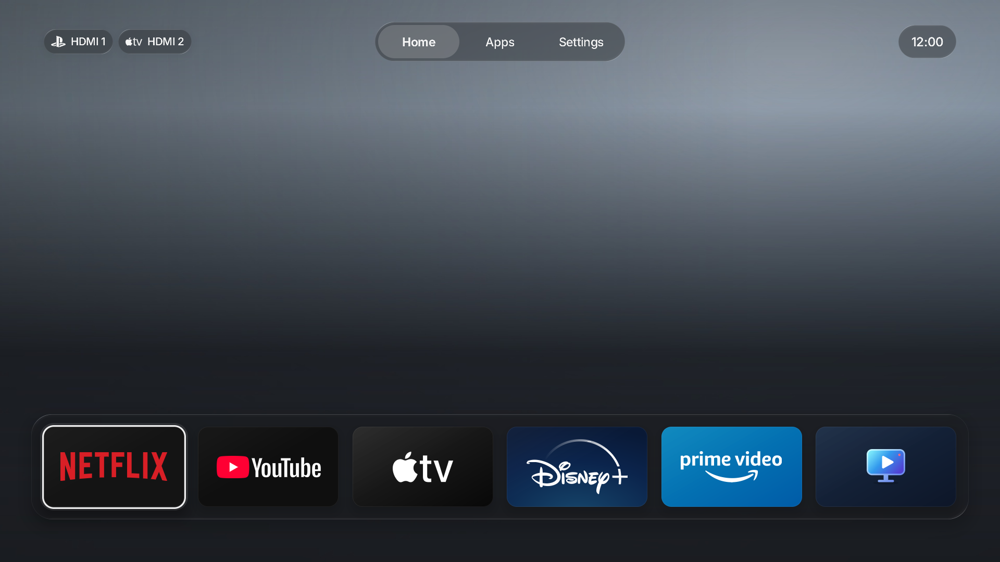
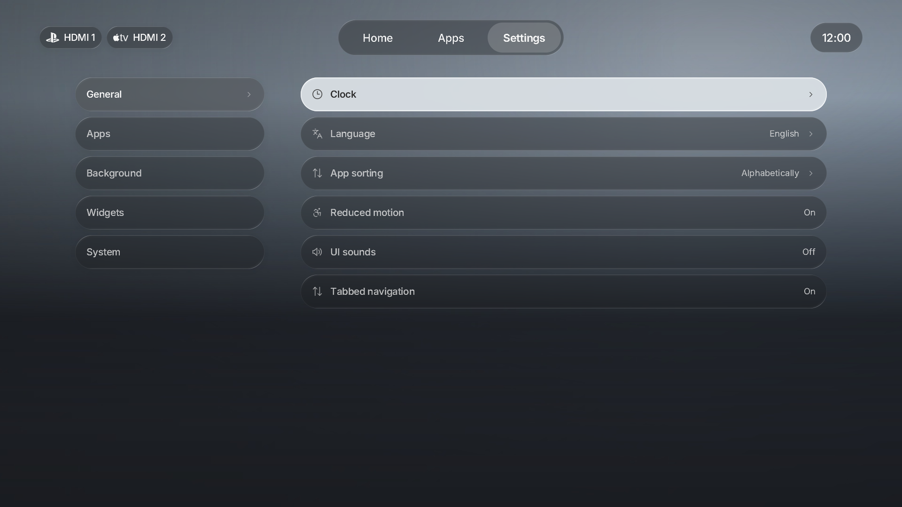

# Home integration on webOS 4

webOS 4 embeds its ribbon launcher in the Qt compositor. It has no separate
`com.webos.app.home` manifest or executable for Luma's newer takeover methods.
The optional legacy integration instead installs a compositor key filter and a
Homebrew startup hook. LG's files remain unchanged.

## Tested device and limits

Hardware testing used an LG **65UK6300YVB**, board **LM18A_DVB_EU**, firmware
**05.50.70**, OS release **4.4.3-22**, SDK **4.4.0**, ARMv7. This is a 2018 model
from the webOS 4.0 family. Other webOS 4 models remain unverified.

The owner confirmed physical Home, Prime and Voice mappings, app navigation and
playback, Recent apps and Close all. Two software restarts verified startup in
Luma. An additional real-TV key test exercised app launch, Home, Recent apps and
Close all, and checked that Home, inputs and system services remained running.
Disable/re-enable restored LG's original behavior and then Luma's routing.
The live tests used the earlier 3.1-based local build. The contribution is rebased
onto 3.2.1 and receives separate code, rendering and ARM package checks; that
rebased package has not been deployed to the TV. Hard power removal and all
Quick Start/standby combinations were not tested.

## Enable or restore

Install the native package and open Luma once. These commands run in a **root
shell on the TV**. The stock webOS 4 Python 2.7 runtime is used; no Python packages
or permanent extra daemon are required.

```sh
cd /media/developer/apps/usr/palm/applications/com.ecklf.luma
python2 legacy-home.py enable
python2 /var/lib/luma-legacy-home/legacy-home.py status
```

For a Homebrew installation under `/media/cryptofs`, use that installation's
application directory instead. Enabling saves the original key filter list,
copies the integration into `/var/lib/luma-legacy-home`, inserts its filter before
LG's system Home handler, creates
`/var/lib/webosbrew/init.d/64-luma-legacy-home`, and opens Luma.

To restore LG routing, including before uninstalling Luma:

```sh
python2 /var/lib/luma-legacy-home/legacy-home.py disable
```

Disable removes only Luma's filter and startup hook. It preserves any later
changes to other filters and retains the backup and copied recovery script.
After updating Luma, disable the old integration and run `enable` from the new
installation directory to refresh the copied integration and reload its filter.

## Behavior

- Home/Menu/Recent requests and the OEM ribbon open Luma.
- Home resets Luma to its Home page even when Settings or Recent apps was left
  open. The reset key is sent only after Luma's actual surface has input focus.
- Back reaches focused Luma while LG overlays retain their own Back behavior.
- Closing a normal foreground app returns to Luma; background memory reclamation
  and switching to another app do not take the screen.
- Existing screen-saver/accessibility filters keep their order. Prime, Voice and
  all unrelated keys pass through; this feature installs no personal mappings.
- A rejected Luma launch falls back to LG Home without a ribbon redirect loop.

## Runtime differences

Older LS2 separates public and private buses. Homebrew's service is on the public
bus. Luma resolves `LSRegisterPubPriv` dynamically for Homebrew requests and uses
the normal registration on newer unified LS2. It does not impersonate an app ID
or retry a mutation on another bus after an ambiguous result.

This tested firmware also lacks `com.webos.service.recent`. Capability detection
selects SAM's real running-card inventory instead of synthetic recent history.
Single and batch closes use SAM and skip unavailable history-removal requests.
Home, inputs, Live TV, AirPlay, the hidden Enyo container and overlays are kept.
The existing history backend remains in use when its service is available.

## Interface choices

**Settings → General → Tabbed navigation** enables Home / Apps / Settings.
The existing drawer is the default when the preference is off. In tabbed mode,
Back on Home opens Recent apps. Up closes the selected app; Down reaches the
bottom-center **X Close all** button, and Up from the button returns to the card.
Close all closes normal
running apps and removes their recent-history cards where supported. Failed
closes are reported instead of being presented as success.

Desktop previews below use isolated demo preferences and sample inventory, not
TV screenshots or the owner's installed-app data:




