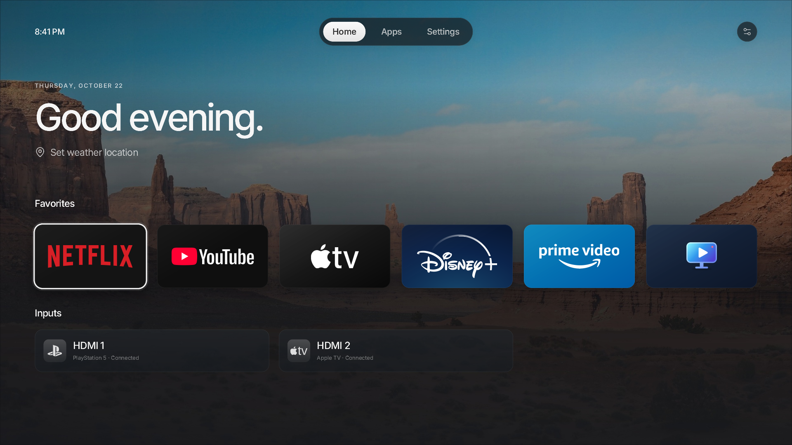
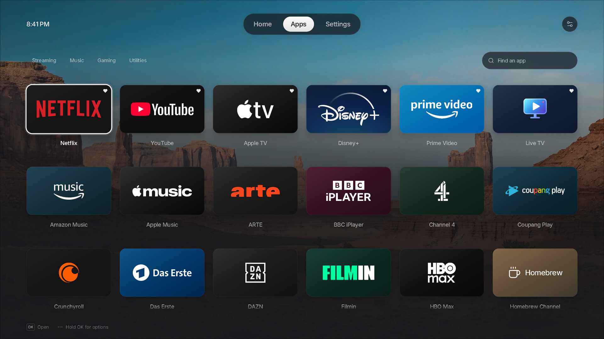
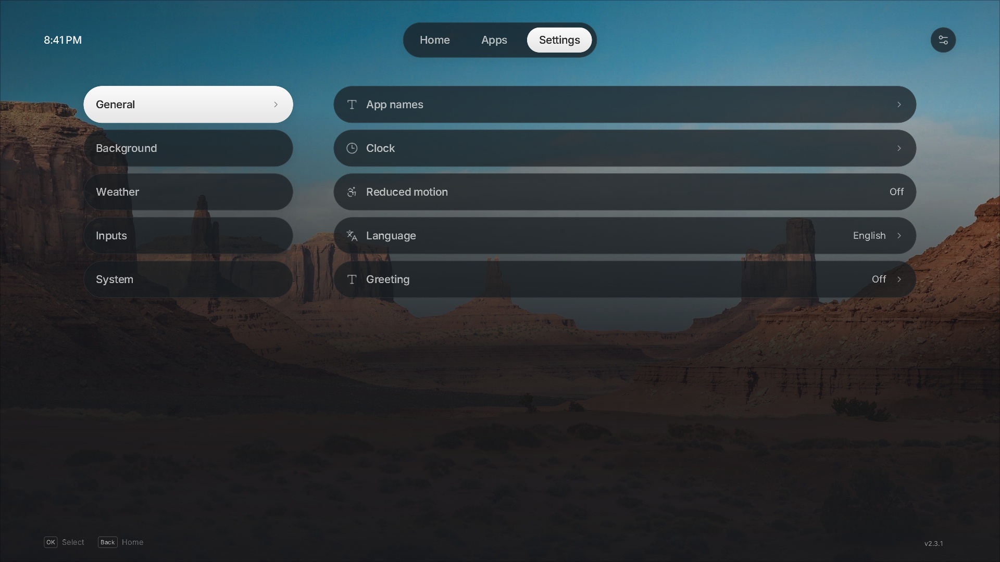
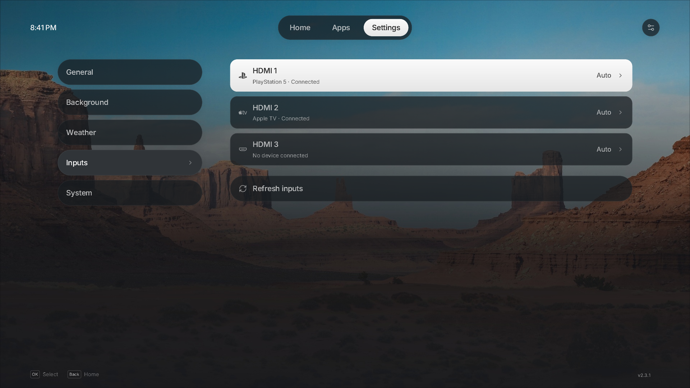

# Luma

A native launcher for rooted LG webOS TVs, inspired by Apple TV.

https://github.com/user-attachments/assets/0c3061bf-c158-417e-85a4-da3eb84ecf08

[Demo video](docs/luma-preview.mp4)

<details>
<summary>Screenshots</summary>

<table>
  <tr>
    <td width="50%" align="center">
      
    </td>
    <td width="50%" align="center">
      
    </td>
  </tr>
  <tr>
    <td width="50%" align="center">
      
    </td>
    <td width="50%" align="center">
      
    </td>
  </tr>
</table>

</details>

## Compatibility

> [!NOTE]
> Luma should start on any TV running webOS 4 or newer. The following configurations have been
> confirmed to work by the community. Home takeover support varies, as noted below:

<details>
<summary>webOS 4</summary>

| TV        | Model identifier | Takeover Support |
| --------- | ---------------- | ---------------- |
| LG C8     | `OLED??C8*`      | ❌               |
| LG C9     | `OLED65C97LA`    | —                |
| LG UM7450 | `UM74507LA`      | ❌               |

</details>

<details>
<summary>webOS 5</summary>

| TV        | Model identifier | Takeover Support |
| --------- | ---------------- | ---------------- |
| LG UN7100 | `49UN71006LB`    | ✅               |

</details>

<details>
<summary>webOS 6</summary>

| TV        | Model identifier | Takeover Support |
| --------- | ---------------- | ---------------- |
| LG C1     | `OLED48C1KNB`    | ✅               |
| LG UP8000 | `86UP80009LA`    | —                |

</details>

<details>
<summary>webOS 24</summary>

| TV    | Model identifier | Takeover Support |
| ----- | ---------------- | ---------------- |
| LG B2 | `OLED65B29LA`    | ✅               |

</details>

<details>
<summary>webOS 25</summary>

| TV        | Model identifier | Takeover Support |
| --------- | ---------------- | ---------------- |
| LG B5     | `OLED77B5PUA`    | ✅               |
| LG C2     | `OLED42C2PSA`    | ✅               |
| LG C2     | `OLED65C2*`      | —                |
| LG C2     | `OLED77C2*`      | —                |
| LG C4     | `OLED42C4*`      | ✅               |
| LG G3     | `OLED??G3*`      | —                |
| LG NANO77 | `55NANO776RA`    | ✅               |
| LG QNED86 | `55QNED86T6A`    | —                |
| LG UT8050 | `50UT8050*`      | —                |

</details>

<details>
<summary>webOS 26</summary>

| TV    | Model identifier      | Takeover Support |
| ----- | --------------------- | ---------------- |
| LG C2 | `OLED65C2PSA`         | ✅               |
| LG C3 | `OLED65C31LA`         | ✅               |
| LG C3 | `OLED65C36LC`         | ✅               |
| LG C5 | `OLED55C57LA`         | ✅               |
| LG C5 | `OLED55C5PSA`         | —                |
| LG C6 | `OLED65C6*`           | —                |
| LG C6 | `OLED77C6*`           | ✅               |
| LG G5 | `OLED83G5WUA.BUSYDJR` | ✅               |

</details>

> [!NOTE]
> Model identifiers containing wildcards are inferred: `??` is an unknown screen size and `*` is an
> unconfirmed regional suffix. `—` indicates information that has not been reported. `❌` means
> Luma runs on the TV, but Home takeover was reported not to work.

## Installation

### Homebrew Channel

```text
https://github.com/ecklf/lg-luma/releases/latest/download/repo.json
```

### SSH

On your computer, replace `TV_IP`:

```sh
scp -O dist/com.ecklf.luma_2.10.3_arm.ipk root@TV_IP:/tmp/luma.ipk
ssh root@TV_IP
```

In the TV's root shell:

```sh
luna-send -i luna://com.webos.appInstallService/dev/install \
  '{"id":"com.ecklf.luma","ipkUrl":"/tmp/luma.ipk","subscribe":true}'
```

## Replacing LG Home

### Takeover Method

> [!NOTE]
> Takeover is supported on **webOS 5, 6, 25 and 26**.\
> The takeover does not delete LG Home: it remains underneath a temporary mount, which is cleared by
> a reboot. If Luma is uninstalled first, LG Home returns on reboot, but the separate takeover boot
> hook remains and logs an error because it can no longer find Luma. No TV reset is needed. For
> clean removal, disable takeover before uninstalling.

Install Luma and verify that it opens normally. Disable any Home-button mapping in
[LG Input Hook](https://github.com/Simon34545/lginputhook) (remove its Home-key action) and any
other Home replacement, then run in the TV's root SSH shell:

If you enabled Lumas autostart method earlier, disable it first:

```sh
APP=/media/developer/apps/usr/palm/applications/com.ecklf.luma
sh "$APP/autostart.sh" disable
```

To enable the takeover run:

```sh
APP=/media/developer/apps/usr/palm/applications/com.ecklf.luma
sh "$APP/home.sh" enable
```

To see the status or disable the home override use:

```sh
sh /var/lib/luma-home/home.sh status
sh /var/lib/luma-home/home.sh disable
```

`restore` is an alias for `disable`.

Boot log: `/var/lib/luma-home/boot.log`. See the
[development guide](development.md#optional-native-home-integration) for implementation details.

<details>
<summary>Method for webOS 5 / 6</summary>

On **webOS 5 and 6**, SAM cannot reread a mounted Home manifest, so `home.sh enable` instead
bind-mounts Luma's executable over LG's `/usr/bin/com.webos.app.home`. LG's Home manifest stays
in place and Luma registers with SAM itself, so the Home key brings the running Luma back instead
of restarting it. The commands and the cold-boot hook are the same.

</details>

<details>
<summary>Method for webOS 25 / 26</summary>

Mounts Luma over the system Home app and reapplies the mount at cold boot. The LG splash
shown before Luma's window opens is the wallpaper you selected in **Settings → Background**, staged
from the saved preferences at each boot. Normal app launches also use your selected wallpaper:
Luma updates the launch splash through Homebrew Channel's root service after loading or saving your
settings. Open Luma once after installing or updating so subsequent launches use your saved background.
LG Home's original files remain underneath, using the same approach as
[Glasshouse Home](https://github.com/rorygallagher2024/glasshouse/blob/main/server/lib/home-takeover.js).

</details>

### Autostart Method

Open Luma 25 seconds after a full cold boot. Run in the TV's root SSH shell:

```sh
sh /media/developer/apps/usr/palm/applications/com.ecklf.luma/autostart.sh enable
```

Use this when takeover is disabled. It launches Luma as a regular app and does not remap the Home button.

Disable before enabling takeover or uninstalling Luma:

```sh
sh /media/developer/apps/usr/palm/applications/com.ecklf.luma/autostart.sh disable
```

### LG Input Hook Method

You can use [LG Input Hook](https://repo.webosbrew.org/apps/org.webosbrew.inputhook/), configure an Execute action with this one-line command:

```sh
/usr/bin/luna-send -n 1 -w 5000 luna://com.webos.service.applicationmanager/launch '{"id":"com.ecklf.luma"}'
```

Test on a spare button first. Disable the mapping in Input Hook to restore normal Home behavior.

## Development

### Setup & Building

From the repository root, with Nix flakes enabled:

```sh
nix develop
pnpm install --frozen-lockfile
pnpm sdk
export WEBOS_NDK="$PWD/.build/toolchain/arm-webos-linux-gnueabi_sdk-buildroot"
pnpm run package
```

The first native runtime preparation also downloads a
checksum-pinned SDL-webOS library; both downloads are cached under `.build/`.

Output:

```text
dist/com.ecklf.luma_2.10.3_arm.ipk
dist/sha256sums
dist/repo.json
dist/app-icon-large.png
```

Open [webOS Dev Manager](https://github.com/webosbrew/dev-manager-desktop), connect to the TV's
IP on port **22** as **root**, and install the IPK. Open **Luma** from the TV menu. Homebrew
Channel must be elevated; on webOS 26 use **0.8.0-rc1 or newer** for its `lunabus.query` mapping.

The native package uses **`com.ecklf.luma`** and installs separately from the old
`com.luma.launcher` web app and the former `com.luma.launcher.native` / `com.luma.native` prototypes. Native preferences
are local JSON files and are separate for each installation; browser preferences are not migrated.
Homebrew Channel treats this ID as a separate app rather than an update to the old launcher.

Wait for installation success; Ctrl+C closes an ongoing subscription. Fully close and reopen
Luma after updating. The [development guide](development.md#tv-startup-diagnostics) has a jailed
launch command that exposes errors hidden by the normal menu launch.

## Preview

```sh
nix develop
pnpm install --frozen-lockfile
pnpm assets
pnpm dev
```

The desktop preview uses sample inventory and never calls TV services. To manually exercise a
longer app grid:

```sh
pnpm dev --test-extra-apps 120
```

Preview preferences are separate from normal preferences. See [development.md](development.md)
for controls, vector rendering, diagnostics, tests and the source layout.

For release-worthy changes, include a file generated by `pnpm changeset` in your PR. The automated
Version Packages PR synchronizes app versions and publishes after merging and passing CI.
See [Releases](development.md#releases) for the workflow and repository setup.

## Privacy and scope

App/input discovery uses fixed inventory commands through Homebrew Channel's elevated service.
App launches use the native Luna bus with declared permissions. There is no demo inventory
fallback on the TV. Native caller permissions and lifecycle behavior can differ by firmware.

Favorites, hidden apps, settings, weather location and cached readings stay in local JSON files
in an app-owned persistent directory outside the installed payload.
Weather search/forecast requests go to Open-Meteo, with embedded TLS roots and bounded responses.
There is no browser geolocation, IP-based location lookup, telemetry or runtime font download.

## License

Luma is licensed under MIT.

Luma is not affiliated with LG, Apple, or any other brands shown in its UI.
