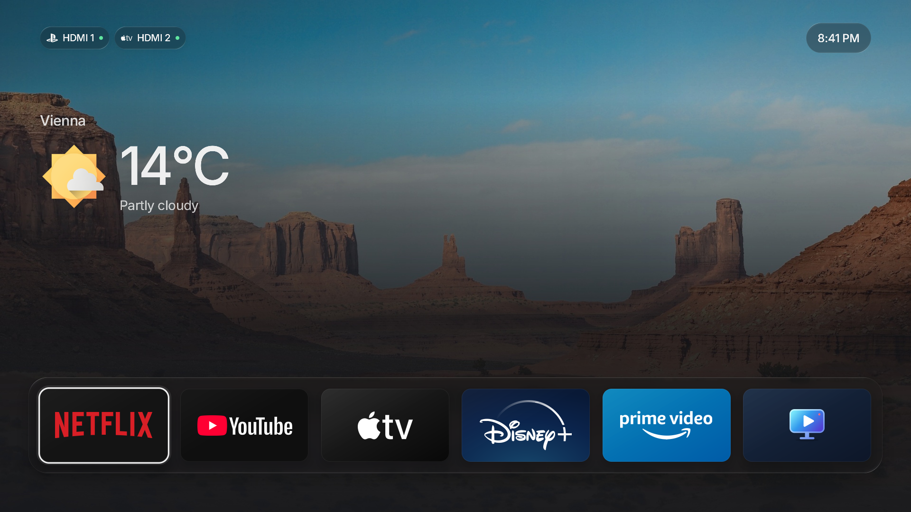
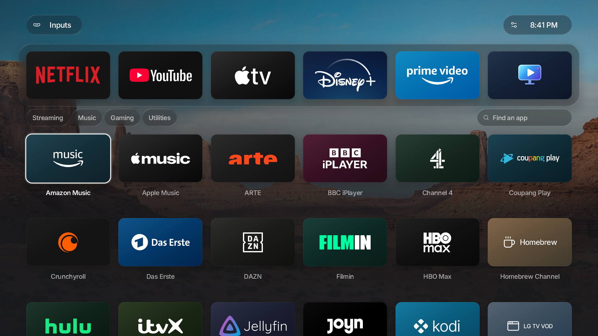
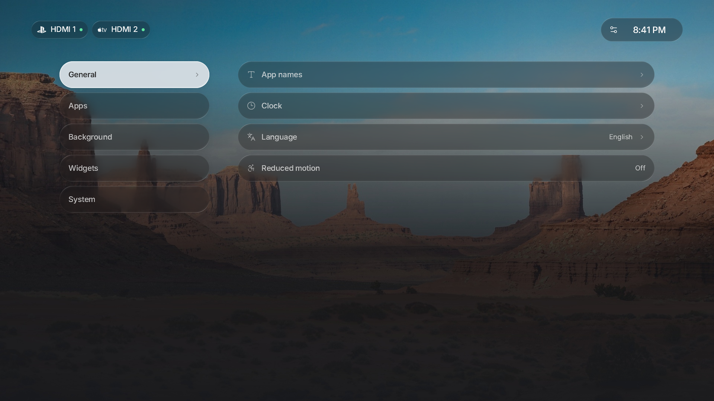
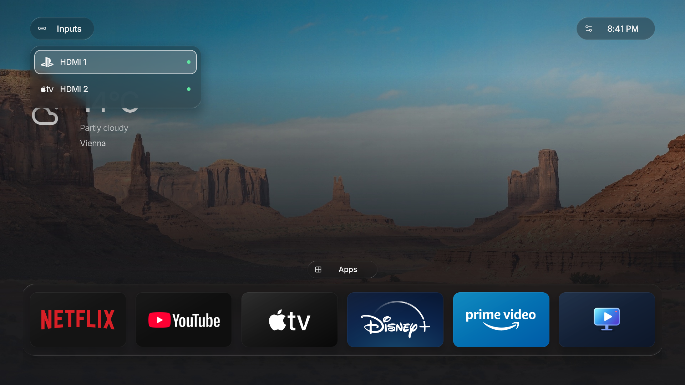

# Luma

A native launcher for rooted LG webOS TVs, inspired by Apple TV.

https://github.com/user-attachments/assets/2156d640-b8fa-4ea4-a02c-0db4c93bcc5a

<details>
<summary>Screenshots</summary>

<table>
  <tr>
    <td width="50%" align="center">
      
    </td>
    <td width="50%" align="center">
      
    </td>
  </tr>
  <tr>
    <td width="50%" align="center">
      
    </td>
    <td width="50%" align="center">
      
    </td>
  </tr>
</table>

</details>

If installed app icons look stale, use **Settings → System → Reset icon cache** to
clear cached artwork and reload it without changing your preferences.

## Compatibility

> [!NOTE]
> Luma should start on any TV running webOS 4 or newer. The following configurations have been
> confirmed to work by the community. Home takeover support varies, as noted below:

<details>
<summary>webOS 4</summary>

| TV        | Model identifier | Takeover Support |
| --------- | ---------------- | ---------------- |
| LG C8     | `OLED??C8*`      | ❌               |
| LG C9     | `OLED65C97LA`    | Unknown          |
| LG UM7450 | `UM74507LA`      | ❌               |

</details>

<details>
<summary>webOS 5</summary>

| TV        | Model identifier | Takeover Support |
| --------- | ---------------- | ---------------- |
| LG UN7100 | `49UN71006LB`    | ✅               |

</details>

<details>
<summary>webOS 6</summary>

| TV        | Model identifier | Takeover Support |
| --------- | ---------------- | ---------------- |
| LG C1     | `OLED48C1KNB`    | ✅               |
| LG G1     | `OLED65G1RLA`    | ✅               |
| LG UP8000 | `86UP80009LA`    | Unknown          |

</details>

<details>
<summary>webOS 24</summary>

| TV        | Model identifier | Takeover Support |
| --------- | ---------------- | ---------------- |
| LG G4     | `OLED65G46LA`    | ✅               |
| LG B2     | `OLED65B29LA`    | ✅               |
| LG QNED81 | `50QNED816RE`    | ✅               |

</details>

<details>
<summary>webOS 25</summary>

| TV        | Model identifier | Takeover Support |
| --------- | ---------------- | ---------------- |
| LG B5     | `OLED77B5PUA`    | ✅               |
| LG C2     | `OLED42C2PSA`    | ✅               |
| LG C2     | `OLED65C2*`      | Unknown          |
| LG C2     | `OLED77C2*`      | Unknown          |
| LG C4     | `OLED42C4*`      | ✅               |
| LG G3     | `OLED??G3*`      | Unknown          |
| LG NANO77 | `55NANO776RA`    | ✅               |
| LG QNED86 | `55QNED86T6A`    | Unknown          |
| LG UT8050 | `50UT8050*`      | ✅               |

</details>

<details>
<summary>webOS 26</summary>

| TV    | Model identifier      | Takeover Support |
| ----- | --------------------- | ---------------- |
| LG C2 | `OLED65C2PSA`         | ✅               |
| LG C3 | `OLED65C31LA`         | ✅               |
| LG C3 | `OLED65C36LC`         | ✅               |
| LG C4 | `OLED77C44LA`         | ✅               |
| LG C5 | `OLED55C57LA`         | ✅               |
| LG C5 | `OLED55C5PSA`         | Unknown          |
| LG C6 | `OLED65C6*`           | Unknown          |
| LG C6 | `OLED77C6*`           | ✅               |
| LG G5 | `OLED83G5WUA.BUSYDJR` | ✅               |
| LG G5 | `OLED77G5WUA.DUSQLJR` | ✅               |

</details>

## Installation

### Homebrew Channel

Add this custom repository URL to Homebrew Channel:

```text
https://github.com/ecklf/lg-luma/releases/latest/download/repo.json
```

Upvote [the official Homebrew Channel repository PR](https://github.com/webosbrew/apps-repo/pull/343)
to bring it to the maintainers' attention.

### SSH

On your computer, replace `TV_IP`:

```sh
scp -O dist/com.ecklf.luma_2.19.0_arm.ipk root@TV_IP:/tmp/luma.ipk
ssh root@TV_IP
```

In the TV's root shell:

```sh
luna-send -i luna://com.webos.appInstallService/dev/install \
  '{"id":"com.ecklf.luma","ipkUrl":"/tmp/luma.ipk","subscribe":true}'
```

## Replacing LG Home

### Takeover Method

> [!NOTE]
> Takeover is supported on **webOS 5, 6, 24, 25 and 26**.\
> On 5, 6 and 24 it replaces the Home executable; on 25 and 26 it mounts Luma's Home app.\
> The takeover does not delete LG Home: it remains underneath a temporary mount, which is cleared by
> a reboot. If Luma is uninstalled first, LG Home returns on reboot, but the separate takeover boot
> hook remains and logs an error because it can no longer find Luma. No TV reset is needed. For
> clean removal, disable takeover before uninstalling.

Install Luma and verify that it opens normally. Disable any Home-button mapping in
[LG Input Hook](https://github.com/Simon34545/lginputhook) (remove its Home-key action) and any
other Home replacement, then run in the TV's root SSH shell:

If you enabled Lumas autostart method earlier, disable it first:

```sh
APP=/media/developer/apps/usr/palm/applications/com.ecklf.luma
sh "$APP/autostart.sh" disable
```

To enable the takeover run:

```sh
APP=/media/developer/apps/usr/palm/applications/com.ecklf.luma
sh "$APP/home.sh" enable
```

To see the status or disable the home override use:

```sh
sh /var/lib/luma-home/home.sh status
sh /var/lib/luma-home/home.sh disable
```

`restore` is an alias for `disable`.

Boot log: `/var/lib/luma-home/boot.log`. See the
[development guide](development.md#optional-native-home-integration) for implementation details.

<details>
<summary>Method for webOS 5 / 6 / 24</summary>

On **webOS 5, 6 and 24**, SAM cannot reread a mounted Home manifest, so `home.sh enable` instead
bind-mounts Luma's executable over LG's `/usr/bin/com.webos.app.home`. LG's Home manifest stays
in place and Luma registers with SAM itself, so the Home key brings the running Luma back instead
of restarting it. The commands and the cold-boot hook are the same.

webOS 24 belongs here rather than with 25/26 because its SAM has no `releaseBlockSystemApp`, so a
mounted Home manifest is never reread and the manifest method fails on that missing method.
Verified on an `OLED65G46LA` (2024 G4, `9.2.4-48`), with community confirmation on a
`50QNED816RE` (`9.2.2-61`, Luma 2.18.0; [#225](https://github.com/ecklf/lg-luma/issues/225)).
These reports do not establish compatibility with every 9.x model or firmware.

On webOS 5/6, a cold boot opens Luma at about 20 s instead of after the Homebrew hook (~50 s or
later). The Homebrew hooks start late, but LG's service hub reads `/var/luna-service2` at
`core-boot-done`. `home.sh enable` therefore also registers a small root helper there
(`com.webos.service.lumahome`, a copy of the package's `luma-early` in `/var/lib/luma-home`) and adds
a compositor key filter (`home-filter.js`) to LG's chain. While the TV boots, the filter asks the
helper to mount Luma and then opens Home. If this fails, the cold-boot hook mounts Luma as before.
Keys pass through the filter unchanged, and `home.sh disable` removes both. The early-boot timing
has not been verified on webOS 24.

</details>

<details>
<summary>Method for webOS 25 / 26</summary>

Mounts Luma over the system Home app and reapplies the mount at cold boot. The LG splash
shown before Luma's window opens is the wallpaper you selected in **Settings → Background**, staged
from the saved preferences at each boot. Normal app launches also use your selected wallpaper:
Luma updates the launch splash through Homebrew Channel's root service after loading or saving your
settings. Open Luma once after installing or updating so subsequent launches use your saved background.
LG Home's original files remain underneath, using the same approach as
[Glasshouse Home](https://github.com/rorygallagher2024/glasshouse/blob/main/server/lib/home-takeover.js).

</details>

### Autostart Method

Open Luma 25 seconds after a full cold boot. Run in the TV's root SSH shell:

```sh
sh /media/developer/apps/usr/palm/applications/com.ecklf.luma/autostart.sh enable
```

Use this when takeover is disabled. It launches Luma as a regular app and does not remap the Home button.

Disable before enabling takeover or uninstalling Luma:

```sh
sh /media/developer/apps/usr/palm/applications/com.ecklf.luma/autostart.sh disable
```

### LG Input Hook Method

You can use [LG Input Hook](https://repo.webosbrew.org/apps/org.webosbrew.inputhook/), configure an Execute action with this one-line command:

```sh
/usr/bin/luna-send -n 1 -w 5000 luna://com.webos.service.applicationmanager/launch '{"id":"com.ecklf.luma"}'
```

Test on a spare button first. Disable the mapping in Input Hook to restore normal Home behavior.

## Features

Choose the interface language in **Settings → General → Language**. Luma supports Catalan,
Czech, Dutch, English, French, German, Italian, Polish, Portuguese (Brazil), Russian,
Simplified Chinese, Spanish, Swedish, Traditional Chinese and Vietnamese.

### Backgrounds

Open **Settings → Background → Upload**, then scan the QR code or open the shown
address on a phone or computer on the same network. Choose a JPEG, PNG or WebP and adjust
its 16:9 crop before choosing **Save to TV**.

The upload link works only while its TV dialog is open and focused.

Enable **Rotation** beside **Upload** to cycle through backgrounds on each Luma restart and every
15 minutes with a slow cross-fade. Rotation is off by default and leaves your manually chosen
LG splash unchanged.

Toggle **Gradient** beside **Rotation** to turn background shading on or off. It defaults to On
and remembers your choice. Older uploads without an unshaded copy keep their full-resolution
shaded image. This does not change LG's launch splash.

### Input icons

Open **Settings → Widgets → Inputs**, select an input, then choose
**Icon** to open a native picker for bundled SVG icons. Choices are **Automatic** (the default,
using label detection), **HDMI**, **USB**, **Apple TV**, **Computer**, **Console**, **PlayStation**,
**NVIDIA Shield**, **Streaming device**, **Nintendo Switch**, **Nintendo Switch 2**, and **Xbox**.

An explicit icon choice is saved separately for each input and persists across restarts.
Choose **Automatic** to clear that input's override and restore label-based icon detection.

### Recent app switching

Press **Back** on Home, or hold **Back** for 0.6 seconds from any page, to open Recent apps.

- **Left / Right**, the pointer, or the scroll wheel browses recent apps and inputs.
- **OK** or a pointer click opens the selected app or input.
- **Up** closes the selected app and removes its card.
- **Back** dismisses the switcher and restores the previous page and focus.

These shortcuts work while Luma is focused. From another app, return to Luma first.

### Shortcut tiles

Shortcut tiles sit on Home like apps but send a web request when selected, for example to a Home
Assistant webhook. Open **Settings → Widgets → Shortcuts → Configure** and scan
the QR code.

## Development

### Setup & Building

From the repository root, with Nix flakes enabled:

```sh
nix develop
pnpm install --frozen-lockfile
pnpm sdk
export WEBOS_NDK="$PWD/.build/toolchain/arm-webos-linux-gnueabi_sdk-buildroot"
pnpm run package
```

The first native runtime preparation also downloads a
checksum-pinned SDL-webOS library; both downloads are cached under `.build/`.

Output:

```text
dist/com.ecklf.luma_2.19.0_arm.ipk
dist/sha256sums
dist/repo.json
dist/app-icon-large.png
```

Open [webOS Dev Manager](https://github.com/webosbrew/dev-manager-desktop), connect to the TV's
IP on port **22** as **root**, and install the IPK. Open **Luma** from the TV menu. Homebrew
Channel must be elevated; on webOS 26 use **0.8.0-rc1 or newer** for its `lunabus.query` mapping.

The native package uses **`com.ecklf.luma`**. Preferences are stored in local JSON files
separately for each installation.

Wait for installation success; Ctrl+C closes an ongoing subscription. Fully close and reopen
Luma after updating. The [development guide](development.md#tv-startup-diagnostics) has a jailed
launch command that exposes errors hidden by the normal menu launch.

## Preview

```sh
nix develop
pnpm install --frozen-lockfile
pnpm assets
pnpm dev
```

The desktop preview uses sample inventory and never calls TV services. To manually exercise a
longer app grid:

```sh
pnpm dev --test-extra-apps 120
```

Preview preferences are separate from normal preferences. See [development.md](development.md)
for controls, vector rendering, diagnostics, tests and the source layout.

For release-worthy changes, include a file generated by `pnpm changeset` in your PR. The automated
Version Packages PR synchronizes app versions and publishes after merging and passing CI.
See [Releases](development.md#releases) for the workflow and repository setup.

## License

Luma is licensed under MIT.\
Luma is not affiliated with LG, Apple, or any other brands shown in its UI.
