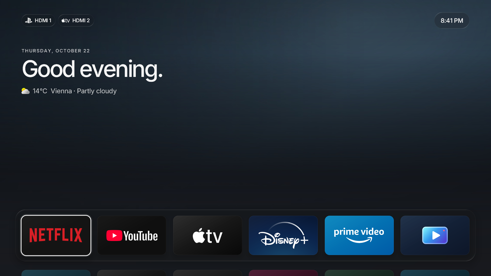
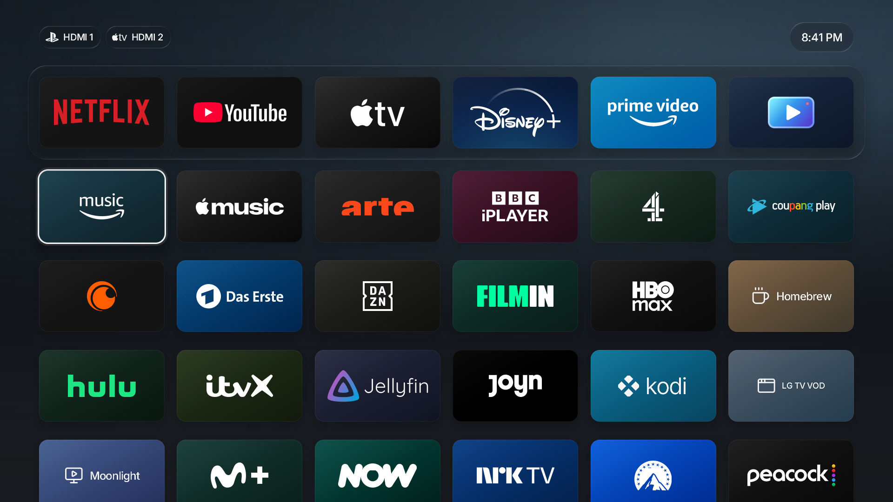
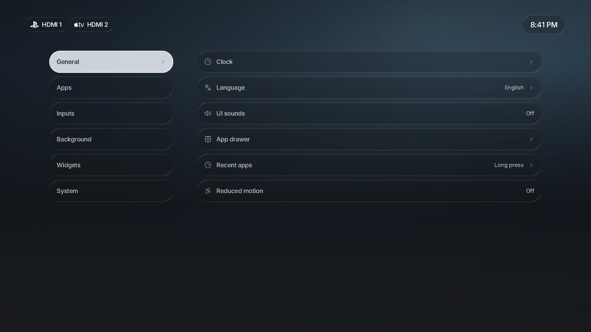
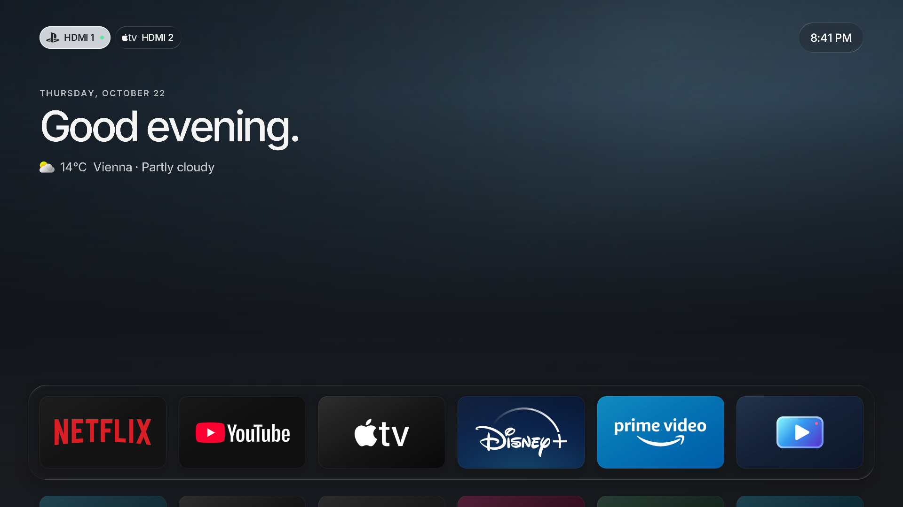

# Luma

A native launcher for rooted LG webOS TVs, inspired by Apple TV.

https://github.com/user-attachments/assets/cae57643-f6b4-47b5-ad7d-0483b32eeb2d

<details>
<summary>Screenshots</summary>

<table>
  <tr>
    <td width="50%" align="center">
      
    </td>
    <td width="50%" align="center">
      
    </td>
  </tr>
  <tr>
    <td width="50%" align="center">
      
    </td>
    <td width="50%" align="center">
      
    </td>
  </tr>
</table>

</details>

## Features

- Customizable app drawer with optional names beneath selected non-favorite apps (off by default), input icons and recent app switching.
- Left/right navigation wraps between the first and last app in favorites and the app drawer.
- Movable greeting, weather, stock and crypto widgets.
- Choose Kuankuan (default), Breezy, Lucide or Kickstand weather artwork, toggle icons on/off, and optionally hide the location name. Layout previews follow these settings.
- Offline credits in System → Attributions, with remote and mouse-wheel scrolling.
- Midnight background and custom uploads, with optional rotation.
- Webhook shortcuts and 16 interface languages.

## Compatibility

> [!NOTE]
> Luma should start on any TV running webOS 4 or newer. The following configurations have been
> confirmed to work by the community. Home takeover support varies, as noted below:

<details>
<summary>webOS 4</summary>

| TV        | Model identifier | Takeover Support |
| --------- | ---------------- | ---------------- |
| LG C8     | `OLED??C8*`      | ❌               |
| LG C9     | `OLED65C97LA`    | Unknown          |
| LG UM7450 | `UM74507LA`      | ❌               |

</details>

<details>
<summary>webOS 5</summary>

| TV        | Model identifier | Takeover Support |
| --------- | ---------------- | ---------------- |
| LG UN7100 | `49UN71006LB`    | ✅               |

</details>

<details>
<summary>webOS 6</summary>

| TV        | Model identifier | Takeover Support |
| --------- | ---------------- | ---------------- |
| LG B1     | `OLED65B19LA`    | ✅               |
| LG C1     | `OLED48C1KNB`    | ✅               |
| LG G1     | `OLED65G1RLA`    | ✅               |
| LG UP8000 | `86UP80009LA`    | Unknown          |

</details>

<details>
<summary>webOS 24</summary>

| TV        | Model identifier | Takeover Support |
| --------- | ---------------- | ---------------- |
| LG G4     | `OLED65G46LA`    | ✅               |
| LG B2     | `OLED65B29LA`    | ✅               |
| LG QNED81 | `50QNED816RE`    | ✅               |

</details>

<details>
<summary>webOS 25</summary>

| TV        | Model identifier | Takeover Support |
| --------- | ---------------- | ---------------- |
| LG B5     | `OLED77B5PUA`    | ✅               |
| LG C2     | `OLED42C2PSA`    | ✅               |
| LG C2     | `OLED65C2*`      | Unknown          |
| LG C2     | `OLED77C2*`      | Unknown          |
| LG C4     | `OLED42C4*`      | ✅               |
| LG G3     | `OLED??G3*`      | Unknown          |
| LG NANO77 | `55NANO776RA`    | ✅               |
| LG QNED86 | `55QNED86T6A`    | Unknown          |
| LG UT8050 | `50UT8050*`      | ✅               |

</details>

<details>
<summary>webOS 26</summary>

| TV    | Model identifier      | Takeover Support |
| ----- | --------------------- | ---------------- |
| LG C2 | `OLED65C2PSA`         | ✅               |
| LG C3 | `OLED65C31LA`         | ✅               |
| LG C3 | `OLED65C36LC`         | ✅               |
| LG C4 | `OLED77C44LA`         | ✅               |
| LG C5 | `OLED55C57LA`         | ✅               |
| LG C5 | `OLED55C5PSA`         | Unknown          |
| LG C6 | `OLED65C6*`           | Unknown          |
| LG C6 | `OLED77C6*`           | ✅               |
| LG G5 | `OLED83G5WUA.BUSYDJR` | ✅               |
| LG G5 | `OLED77G5WUA.DUSQLJR` | ✅               |

</details>

## Installation

### Homebrew Channel

Open Homebrew Channel, find **Luma** in the default
[webOS Homebrew apps repository](https://github.com/webosbrew/apps-repo), and select **Install**.
No custom repository needs to be added manually.

### SSH

On your computer, replace `TV_IP`:

```sh
scp -O dist/com.ecklf.luma_3.13.2_arm.ipk root@TV_IP:/tmp/luma.ipk
ssh root@TV_IP
```

In the TV's root shell:

```sh
luna-send -i luna://com.webos.appInstallService/dev/install \
  '{"id":"com.ecklf.luma","ipkUrl":"/tmp/luma.ipk","subscribe":true}'
```

## Replacing LG Home

### Home Chooser (recommended)

Luma requests foreground Home-key handling on native webOS, including ordinary tile launches:
Home returns directly to Luma's Home tab and stays there at the root. This does not require the
Home Chooser launcher API or add an installation permission. Actual key delivery and routing
while another app is foreground still need TV verification.

[Home Chooser](https://github.com/webosbrew/home-chooser/) is the recommended way to select Luma
as the full-screen Home app without Luma's takeover scripts or an Input Hook mapping:

> [!IMPORTANT]
> Disable any previous takeover, autostart or Home-key mapping **before selecting Luma in
> Home Chooser**. See the **Old methods** block below for disable instructions.

1. Disable any old methods you previously enabled (see **Old methods** below).
2. Install Home Chooser from Homebrew Channel and open it once to finish its root setup.
3. Install or update Luma, then open Home Chooser, select **Luma**, and confirm. Press Home to try it.

<details>
<summary>Old methods</summary>

These legacy methods are kept for reference. Use **Home Chooser (recommended)** above for new
setups. Disable any enabled old method before switching to Home Chooser.

### Takeover Method

> [!NOTE]
> Takeover is supported on **webOS 5, 6, 24, 25 and 26**.\
> On 5, 6 and 24 it replaces the Home executable; on 25 and 26 it mounts Luma's Home app.\
> The takeover does not delete LG Home: it remains underneath a temporary mount, which is cleared by
> a reboot. If Luma is uninstalled first, LG Home returns on reboot, but the separate takeover boot
> hook remains and logs an error because it can no longer find Luma. No TV reset is needed. For
> clean removal, disable takeover before uninstalling.

Install Luma and verify that it opens normally. Disable any Home-button mapping in
[LG Input Hook](https://github.com/Simon34545/lginputhook) (remove its Home-key action) and any
other Home replacement, then run in the TV's root SSH shell:

If you enabled Lumas autostart method earlier, disable it first:

```sh
APP=/media/developer/apps/usr/palm/applications/com.ecklf.luma
sh "$APP/autostart.sh" disable
```

To enable the takeover run:

```sh
APP=/media/developer/apps/usr/palm/applications/com.ecklf.luma
sh "$APP/home.sh" enable
```

To see the status or disable the home override use:

```sh
sh /var/lib/luma-home/home.sh status
sh /var/lib/luma-home/home.sh disable
```

`restore` is an alias for `disable`.

Boot log: `/var/lib/luma-home/boot.log`. See the
[development guide](development.md#optional-native-home-integration) for implementation details.

<details>
<summary>Method for webOS 5 / 6 / 24</summary>

On **webOS 5, 6 and 24**, SAM cannot reread a mounted Home manifest, so `home.sh enable` instead
bind-mounts Luma's executable over LG's `/usr/bin/com.webos.app.home`. LG's Home manifest stays
in place and Luma registers with SAM itself, so the Home key brings the running Luma back instead
of restarting it. The commands and the cold-boot hook are the same.

webOS 24 belongs here rather than with 25/26 because its SAM has no `releaseBlockSystemApp`, so a
mounted Home manifest is never reread and the manifest method fails on that missing method.

On webOS 5/6, a cold boot opens Luma at about 20 s instead of after the Homebrew hook (~50 s or
later). The Homebrew hooks start late, but LG's service hub reads `/var/luna-service2` at
`core-boot-done`. `home.sh enable` therefore also registers a small root helper there
(`com.webos.service.lumahome`, a copy of the package's `luma-early` in `/var/lib/luma-home`) and adds
a compositor key filter (`home-filter.js`) to LG's chain. While the TV boots, the filter asks the
helper to mount Luma and then opens Home. If this fails, the cold-boot hook mounts Luma as before.
Keys pass through the filter unchanged, and `home.sh disable` removes both. The early-boot timing
has not been verified on webOS 24.

On webOS 5/6, Home takeover preserves the TV's input policy. An experimental
[power-on and Back/Exit policy](#optional-power-on-and-backexit-policy-webos-56) can open Luma
instead of the last input; tested on webOS 5.6.2 only, not verified on webOS 24.

</details>

<details>
<summary>Method for webOS 25 / 26</summary>

Mounts Luma over the system Home app and reapplies the mount at cold boot. The launch splash
uses a centered Luma logo on a dark-gray background, independent of your selected wallpaper.
Normal app launches and staged Home launches use the same static image, with no runtime splash updates.
LG Home's original files remain underneath, using the same approach as
[Glasshouse Home](https://github.com/rorygallagher2024/glasshouse/blob/main/server/lib/home-takeover.js).

</details>

### Autostart Method

Open Luma 25 seconds after a full cold boot. Run in the TV's root SSH shell:

```sh
sh /media/developer/apps/usr/palm/applications/com.ecklf.luma/autostart.sh enable
```

Use this when takeover is disabled. It launches Luma as a regular app and does not remap the Home button.

Disable before enabling takeover or uninstalling Luma:

```sh
sh /media/developer/apps/usr/palm/applications/com.ecklf.luma/autostart.sh disable
```

### Optional power-on and Back/Exit policy (webOS 5/6)

Requires executable Home takeover; this command is not supported on webOS 25/26's manifest method.
On webOS 25, LG provides **Settings → General → System → Additional Settings → Home Settings →
Power On Screen → Home** for startup selection ([LG guide](https://www.lg.com/us/support/help-library/lg-tv-choosing-your-power-on-screen--20154629491064)).
That setting does not configure Back/Exit behavior or guarantee Luma launches after takeover.

Home takeover alone preserves the TV's input policy. After enabling Home takeover, owners who
want Luma instead of the last TV input at power-on and after leaving apps can explicitly run:

```sh
sh /var/lib/luma-home/home.sh startup-home on
# Restore the saved power-on and Back/Exit input while keeping Home takeover:
sh /var/lib/luma-home/home.sh startup-home off
```

Select the desired fallback TV input before opting in. This experimental policy pins EIM's
last-input file read-only; tested on webOS 5.6.2 only. Disabling takeover also restores the saved
input. Existing draft installations without a saved prior setting use the input recorded in
EIM's `appId` as their migration fallback.

### LG Input Hook Method

You can use [LG Input Hook](https://repo.webosbrew.org/apps/org.webosbrew.inputhook/), configure an Execute action with this one-line command:

```sh
/usr/bin/luna-send -n 1 -w 5000 luna://com.webos.service.applicationmanager/launch '{"id":"com.ecklf.luma"}'
```

Test on a spare button first. Disable the mapping in Input Hook to restore normal Home behavior.

</details>

## Development

### Setup & Building

From the repository root, with Nix flakes enabled:

```sh
nix develop
pnpm install --frozen-lockfile
pnpm sdk
export WEBOS_NDK="$PWD/.build/toolchain/arm-webos-linux-gnueabi_sdk-buildroot"
pnpm run package
```

The first native runtime preparation also downloads a
checksum-pinned SDL-webOS library; both downloads are cached under `.build/`.

Output:

```text
dist/com.ecklf.luma_3.13.2_arm.ipk
dist/sha256sums
dist/repo.json
dist/app-icon-large.png
```

Open [webOS Dev Manager](https://github.com/webosbrew/dev-manager-desktop), connect to the TV's
IP on port **22** as **root**, and install the IPK. Open **Luma** from the TV menu. Homebrew
Channel must be elevated; on webOS 26 use **0.8.0-rc1 or newer** for its `lunabus.query` mapping.

The native package uses **`com.ecklf.luma`**. Preferences are stored in local JSON files
separately for each installation.

Wait for installation success; Ctrl+C closes an ongoing subscription. Fully close and reopen
Luma after updating. The [development guide](development.md#tv-startup-diagnostics) has a jailed
launch command that exposes errors hidden by the normal menu launch.

## Preview

```sh
nix develop
pnpm install --frozen-lockfile
pnpm assets
pnpm dev
```

The desktop preview uses sample inventory and never calls TV services. To manually exercise a
longer app grid:

```sh
pnpm dev --test-extra-apps 120
```

Preview preferences are separate from normal preferences. See [development.md](development.md)
for controls, vector rendering, diagnostics, tests and the source layout.

SDL-recognized game controllers can navigate with the D-pad or left stick, select with
Cross / A, go back with Circle / B, and open options with Options / Start. Controller
availability, including PS5 DualSense USB/Bluetooth connections, depends on TV firmware
and the SDL backend and requires verification on your TV.

## License

Luma's code is licensed under MIT. Bundled [Breezy Weather icons](assets/weather/README.md)
are separately licensed under LGPL-3.0.\
Luma is not affiliated with LG, Apple, or any other brands shown in its UI.
